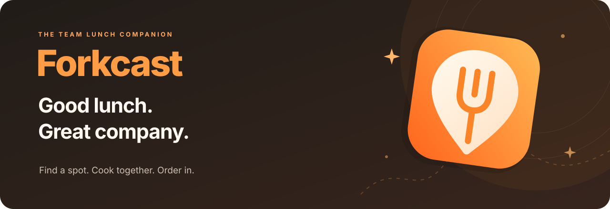
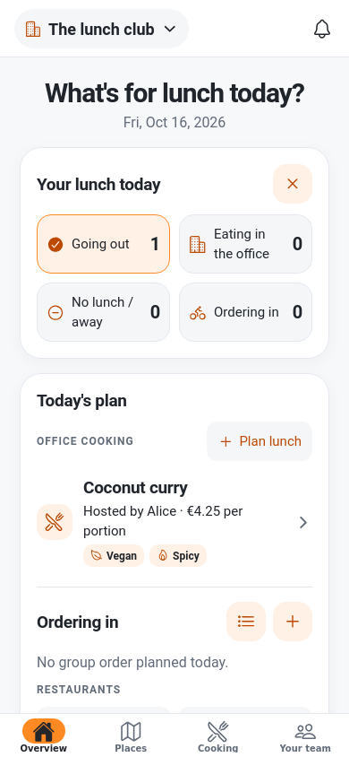
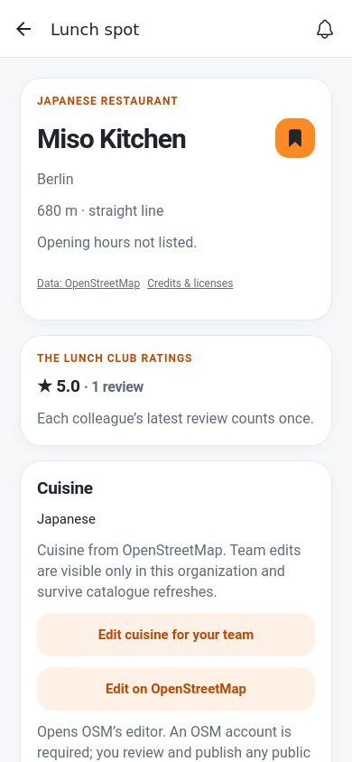
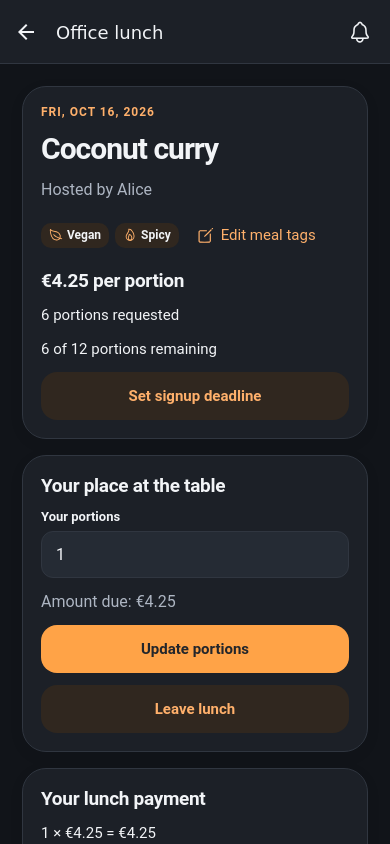

  

  
  
  
  

  Your team's daily lunch plans, favorite spots and shared meals — all at one table. 
  Open source. Ready to self-host. At home on your phone.

  <a href="https://github.com/edriste/Forkcast/wiki"><strong>Explore the docs</strong></a>
  &nbsp; · &nbsp;
  <a href="https://github.com/edriste/Forkcast/wiki/Self-hosting"><strong>Host your own</strong></a>
  &nbsp; · &nbsp;
  <a href="docs/development.md"><strong>Run locally</strong></a>

## Bring your team to the table

| 🍴 Decide together                                                                                               | 📍 Find your next favorite                                                                                    | 🍲 Share a meal                                                                                   |
| ---------------------------------------------------------------------------------------------------------------- | ------------------------------------------------------------------------------------------------------------- | ------------------------------------------------------------------------------------------------- |
| See who's in for lunch, nominate a restaurant and vote. Let the wheel pick when everyone is feeling adventurous. | Explore nearby spots on a map or in a list. Save favorites, share reviews and check the walk from the office. | Organize office cooking or a group order, with signups, deadlines, comments and payment tracking. |

## A taste of Forkcast

<table>
  <tr>
    <th>Today's lunch</th>
    <th>Your favorite spots</th>
    <th>Cooking together</th>
  </tr>
  <tr>
    <td></td>
    <td></td>
    <td></td>
  </tr>
</table>

Actual app screens with fictional demo data. English/German and light/dark appearance follow your system settings.

## Make it yours

Forkcast supports multiple organizations, shared administration, live updates and an in-app notification inbox. Optional device push keeps colleagues informed with grouping, quiet hours and daily limits.

| Get started              |                                                                                                             |
| ------------------------ | ----------------------------------------------------------------------------------------------------------- |
| **On your own server**   | [Self-host with Docker](https://github.com/edriste/Forkcast/wiki/Self-hosting)                              |
| **With managed hosting** | [Deploy the PWA on Cloudflare + Supabase](https://github.com/edriste/Forkcast/wiki/Cloudflare-and-Supabase) |
| **On your phone**        | [Install Forkcast on your home screen](https://github.com/edriste/Forkcast/wiki/Install-on-your-phone)      |
| **As a contributor**     | [Local setup and checks](docs/development.md)                                                               |

Built with **Expo · React Native · TypeScript · Supabase · MapLibre**. See the [wiki](https://github.com/edriste/Forkcast/wiki) for provider configuration, authentication and maintenance, or the [user guide](https://github.com/edriste/Forkcast/wiki/Using-Forkcast) for a tour.

## Open source, ready to share

[MIT licensed](LICENSE). Self-host, modify and redistribute Forkcast, including commercially, while retaining the license notice. Third-party components and external data keep their [own licenses](THIRD_PARTY_NOTICES.md).
